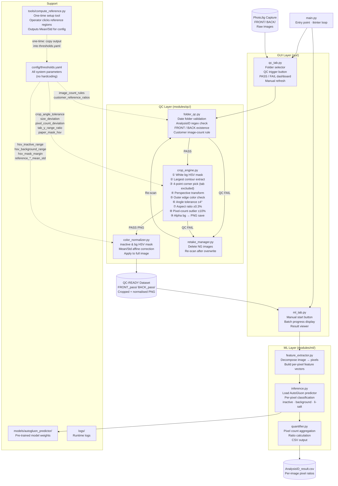

# Battery PhotoJig QC + ML Vision System — Architecture

---

## Full System Architecture



---

## Data Flow — Step by Step

```
PhotoJig Capture
    └─ ROOT/{DATE}/{AnalysisID}/FRONT/ & BACK/
           │
           ▼ [QC TAB]
    folder_qc.py
    · Date folder exists (YYYY-MM-DD, M-D-YYYY, M-D-YY)
    · AnalysisID matches [A-Z]{3}[0-9]{5}
    · FRONT and BACK folders exist
    · Image count matches customer rule (H:30 / F:38 / V:23 / S,T:any)
           │ FAIL ──► retake_manager.py (delete NG, re-scan)
           │ PASS
           ▼
    crop_engine.py  (per image)
    ① HSV white-paper mask  (0,0,200)–(180,50,255)
    ② Largest contour  (body + tab as one)
    ③ 4-point extraction  (tab region excluded from left corners)
    ④ Perspective transform → rectified rectangle
    ⑤ Outer edge pixels must NOT be background yellow → else FAIL
    ⑥ Angle deviation ≤ ±4° → else FAIL
    ⑦ Aspect ratio within ±0.3% of customer reference → else FAIL
    ⑧ Pixel count within ±10% of folder mean → else FAIL
    ⑨ Background pixels → alpha transparent → save PNG
           │ FAIL ──► retake_manager.py
           │ PASS
           ▼
    color_normalizer.py
    · Extract inactive & background region masks (HSV ± hsv_mask_margin)
    · Compute per-channel Mean/Std from each region
    · Derive affine correction vs. reference stats from config
    · Apply correction to entire image
           │
           ▼
    FRONT_pass/ & BACK_pass/   ← QC-READY dataset
           │
           ▼ [ML TAB — manual trigger]
    feature_extractor.py
    · Decompose each image into individual pixels
    · Build feature vector per pixel
           │
           ▼
    inference.py
    · Load models/autogluon_predictor/
    · Predict class per pixel: inactive | background | li-salt
           │
           ▼
    quantifier.py
    · Count pixels per class
    · inactive_ratio + background_ratio + li_salt_ratio = 1.0
    · Write {AnalysisID}_result.csv inside AnalysisID folder
```

---

## Module Roles and Connections

| Module | Role | Receives from | Sends to |
|--------|------|--------------|----------|
| `main.py` | App entry point; starts tkinter loop; mounts both tabs | — | qc_tab, ml_tab |
| `gui/qc_tab.py` | QC tab UI: folder picker, run button, PASS/FAIL dashboard, manual refresh | User input, raw images | folder_qc, crop_engine, color_normalizer, retake_manager |
| `gui/ml_tab.py` | ML tab UI: manual start, batch progress, result viewer | QC-READY images | feature_extractor, inference, quantifier |
| `modules/qc/folder_qc.py` | Validates folder hierarchy, AnalysisID format, and per-customer image count | Raw folder path | crop_engine (on pass), retake_manager (on fail) |
| `modules/qc/crop_engine.py` | Detects electrode contour, corrects perspective, validates geometry, saves alpha PNG | folder_qc output | color_normalizer (on pass), retake_manager (on fail) |
| `modules/qc/color_normalizer.py` | Applies Mean/Std affine colour correction using reference statistics from config | crop_engine PNG output | FRONT_pass / BACK_pass folders |
| `modules/qc/retake_manager.py` | Deletes NG images; triggers re-scan after operator overwrites with new capture | folder_qc / crop_engine FAIL signal | folder_qc (re-scan) |
| `modules/ml/feature_extractor.py` | Decomposes each QC-READY image into per-pixel feature vectors | FRONT_pass / BACK_pass PNGs | inference.py |
| `modules/ml/inference.py` | Loads AutoGluon model; classifies each pixel as inactive / background / li-salt | feature_extractor output | quantifier.py |
| `modules/ml/quantifier.py` | Counts classified pixels; calculates ratios; writes result CSV | inference output | {AnalysisID}_result.csv |
| `tools/compute_reference.py` | One-time setup: operator clicks inactive/background regions on reference image; prints Mean/Std values ready to paste into config | Reference image (manual) | config/thresholds.yaml (manual copy) |
| `config/thresholds.yaml` | Single source of truth for all thresholds and reference values; no hardcoding allowed | compute_reference.py (manual) | folder_qc, crop_engine, color_normalizer |

---

## Config Values — thresholds.yaml

| Key | Controls |
|-----|----------|
| `crop_angle_tolerance` | Maximum allowed rotation angle after perspective transform (±4°). Exceeding → QC FAIL. |
| `size_deviation` | Maximum allowed deviation from customer reference aspect ratio (±0.3%). Exceeding → QC FAIL. |
| `pixel_count_deviation` | Maximum allowed deviation from mean pixel count within the same FRONT/BACK folder (±10%). Exceeding → QC FAIL. |
| `hsv_mask_margin` | Margin applied to both ends of each HSV channel during ColorNormalizer mask extraction (recommended: 5). H channel clipped to 0–179. |
| `tab_y_range_ratio` | Fraction of bounding-rect height treated as the tab region on the left side. Points in this y-range are excluded from 4-point corner extraction (middle 50%). |
| `customer_reference_ratios` | Width/height aspect ratios per customer used for size tolerance check. HKMC: 3.306 · FORD: 2.566 · VW: 5.203. |
| `image_count_rules` | Required image count per FRONT/BACK folder per customer. HKMC: 30 · FORD: 38 · VW: 23 · Slate/Test: unrestricted. |
| `paper_mask_hsv` | HSV lower/upper bounds for white paper background detection in CropEngine. Default: (0,0,200)–(180,50,255). |
| `hsv_inactive_range` | HSV bounds for the inactive region used by ColorNormalizer mask estimation. H: 0–179 · S: 4–164 · V: 72–158. |
| `hsv_background_range` | HSV bounds for the background region used by ColorNormalizer mask estimation. H: 19–22 · S: 155–197 · V: 201–255. |
| `reference_inactive_mean_std` | Per-channel (B/G/R) Mean and Std of the inactive region in the reference image. Computed once by compute_reference.py and pasted manually. |
| `reference_background_mean_std` | Per-channel (B/G/R) Mean and Std of the background region in the reference image. Computed once by compute_reference.py and pasted manually. |
